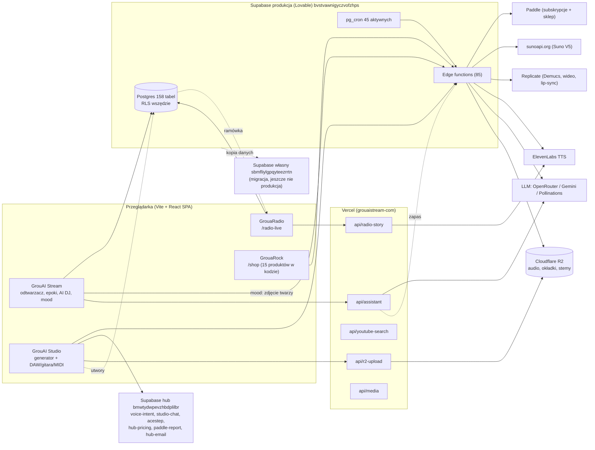

# Audyt ekosystemu GrouAI (L0) — 4.11.2026

Tryb: tylko odczyt (repo, Vercel, baza produkcyjna Supabase przez zapytania SELECT). Bez zmian w kodzie i na produkcji.
Źródła: repozytorium `Greg197512/grouaistream-com` (gałąź `main`), Vercel (team `grzegorz-s-projects2`), baza `bvstvawnigyczvofzhps`.
Lista zadań: [`docs/agent-todo.md`](../agent-todo.md). Decyzje: [`docs/decisions.md`](../decisions.md).

## Najważniejsze wnioski

1. **Baza produkcyjna nie zgadza się z repo.** Historia migracji kończy się na 1.09 (183 wpisy, 193 pliki). Część późniejszych zmian wprowadzono ręcznie, części brakuje: `shop_orders`, `gift_codes`, `radio_stations`, `radio_story_slots`, `locked_tracks`, `blog_promos`, `tracks.catalog_hidden`. **Skutek: zamówienia w sklepie GrouaRock nie mogą działać na produkcji.**
2. **Brak środowiska staging i brak testów w CI.** Każdy push na `main` od razu wdraża produkcję (Vercel + 2 workflow GitHub). 16 plików testów działa tylko lokalnie, lint ma 686 błędów, 7 plików wyłącza sprawdzanie typów (`@ts-nocheck`, w tym `RadioLive.tsx`).
3. **Wykrywanie nastroju z kamery łamie zasady RODO z promptu.** Klatka JPEG twarzy trafia do darmowych modeli wizyjnych na OpenRouterze (Llama 3.2 Vision, Qwen VL). Brak osobnej zgody i DPIA.
4. **W Vercelu brakuje kluczy.** Ustawione są tylko `VITE_SUPABASE_*`. Kod oczekuje też: kluczy AI, R2, `YOUTUBE_API_KEY`, `TELEGRAM_*`. Wyszukiwarka YouTube, alerty i wysyłka plików przez Vercel nie mają konfiguracji.
5. **Trzy projekty Supabase.** Produkcja (Lovable), nowy własny (`sbmfliylgpqyteezrrtn`, migracja w toku) i stary „hub” (`bmwtydwpevzhbdplilbr`). Od huba wciąż zależą: komendy głosowe, czat Studia, ACE-Step, cennik B2B, raport Paddle, e-maile, geolokalizacja.
6. **45 aktywnych cronów w bazie**, wiele z nich codziennie woła modele AI (marketing, aurora, podcasty, TikTok). Nie ma budżetów per moduł z progami 80% i 100%.
7. **Duplikaty wdrożeń:** projekty Vercel `grouaistream` i `dist` budują się przy każdym pushu, a workflow `deploy.yml` wdraża drugi raz na produkcję (`--prod`).

## Mapa zależności

Zależności krytyczne między modułami:
- **Studio → Radio:** ręcznie, przez tabelę `tracks` i `radio_schedule`. Nie ma wersjonowanego API ani kolejki zadań ze stałą kontrolą jakości przed anteną.
- **Stream ↔ Radio:** wspólna tabela `tracks`. Audycje (Nocna Rozmowa) są wpisami w `tracks`, więc filtr w interfejsie musi je ukrywać.
- **Shop → Stream:** zakup daje kod VIP (`gift_codes`). Działa dopiero po migracji.

## Inwentarz

| Obszar | Stan |
| --- | --- |
| Stack | Vite + React 18 + TypeScript, Tailwind, framer-motion; 83 zależności, ~112 tys. linii w `src` (53 strony, 275 komponentów) |
| Hosting | Vercel Pro, projekt `grouaistream-com`; duplikaty `grouaistream`, `dist` |
| Funkcje Vercel | 13 w `api/`: assistant, ai, r2-upload, media, youtube-search, radio-story, radio-admin, diag-tracks, health, news-feed, site-guardian, agents-run, migrate-media |
| Baza | Supabase (Lovable): 158 tabel, RLS włączony na wszystkich, 348 polityk; 85 funkcji edge |
| Pliki | Cloudflare R2, kubełek `grouaistream-tracks` (publiczny r2.dev, bez CORS) |
| CI/CD | Workflow: deploy Vercel (backup `--prod`), deploy funkcji Supabase (2 workflow: Lovable i własny projekt), health-monitor co 5 min, pobieranie grafik z Canvy. **Brak testów i lintu w CI.** |
| Zmienne Vercel (nazwy) | ustawione: `VITE_SUPABASE_URL`, `VITE_SUPABASE_PUBLISHABLE_KEY`. Oczekiwane, brak: `GEMINI_API_KEY`, `GROQ_API_KEY`, `OPENROUTER_API_KEY`, `XAI_API_KEY`, `OPENAI_API_KEY`, `R2_*`/`S3_*`, `YOUTUBE_API_KEY`, `TELEGRAM_BOT_TOKEN`, `TELEGRAM_CHAT_ID`, `SITE_URL`, `AI_MODEL_*` |
| Największe tabele | `agent_events` 121 MB (2,7 tys. wierszy), `tracks` 26 MB, `brain_memory` 16 MB, `radio_schedule` 5,5 MB |

## Moduły

### GrouAI Stream (produkcja)
- **Działa:** odtwarzacz (granie w tle, Media Session), epoki, playlisty AI, AI DJ, wykrywanie nastroju, ranking twórców, wsparcie „kawa”, asystent tekstowy i głosowy (łańcuch dostawców z zapasem), PWA.
- **Bezpieczeństwo:**
  - Brak sekretów z uprawnieniami serwisowymi w kodzie; w repo są tylko publiczne klucze anon (dopuszczalne).
  - Otwarty zapis bez logowania w 3 tabelach: `blog_newsletter_subscribers`, `reel_requests`, `dj_session_guests`. Brak limitów zapytań.
  - Bez uwierzytelnienia i limitów: `api/youtube-search` (zużywa limit klucza YouTube), `api/media`, `api/news-feed`.
- **Zgodność:**
  - Kamera w wykrywaniu nastroju wysyła zdjęcie twarzy do zewnętrznych darmowych modeli; brak osobnej zgody i DPIA.
  - Brak banera zgód na cookies (nie znaleziono komponentu zgód).
  - Brak widocznego oznaczenia „AI” przy prezenterze radia i głosach TTS. Utwory wgrane z Suno mają znaczek AI-Assisted.
- **Jakość:** 686 błędów lintu, 7 plików z `@ts-nocheck`, 16 plików testów (DAW, audio, podpis SigV4, nastrój, katalog), nieuruchamianych w CI.

### GrouAI Studio (do rozbudowy)
- **Działa:**
  - generowanie przez sunoapi.org (Suno V5), archiwizacja na R2, przygotowanie do Spotify (−14 LUFS, WAV, okładka 3000, znaczek);
  - tryby Szybki i Zaawansowany, analiza nastroju opisu;
  - Studio Pro: DAW, gitara, MIDI, stroik, rozkładanie na ścieżki (Replicate Demucs), wideo i teledysk.
- **Luki:**
  - Brak wersjonowanego API dla Radia: kolejka, ponawianie, koszt na utwór.
  - Część funkcji (czat Studia, ACE-Step) zależy od huba.
  - Licencje komercyjne Suno (przez sunoapi.org) i ElevenLabs nie są udokumentowane w repo.

### GrouaRadio (do rozbudowy)
- **Działa:**
  - antena 24/7 z ramówki `radio_schedule` (2,5 tys. wpisów), cotygodniowe przetasowanie, top 10 co godzinę;
  - dżingle, audycje nocne (Nocna Rozmowa, opowiadania w 4 językach), prośby słuchaczy, głos na żywo, wykrywanie nastroju w radiu;
  - granie przy zgaszonym ekranie.
- **Luki:**
  - Brak silnika bloków gatunkowych z zasadami rotacji (np. weekend Disco/Electronic/Hip-Hop, brak powtórek w oknie X godzin).
  - Brak bramki jakości przed anteną (LUFS, cisza, długość). Kod pomiaru głośności już jest w Studio i można go użyć.
  - Brak persony prezentera i filtrów treści w specyfikacji.
  - Brak ujawnienia AI na antenie.
  - Słuchowisko `radio-drama` jest wyłączone flagą.
- **Niezawodność:** jest katalog awaryjny (snapshot `tracks.json`) i przeskakiwanie martwych plików; brak monitoringu samego strumienia.

### GrouaRock (do zbudowania)
- **Stan (praca innej sesji z 1.11):**
  - strona `/shop`: 15 produktów wpisanych w kod (10 odzież, 2 dodatki, 2 gadżety AI, 1 dom; 2 w przedsprzedaży), koszyk, zamówienia;
  - funkcja `shop-checkout` z Paddle: tryb live wyłączony flagą `SHOP_PADDLE_LIVE`;
  - panel admina, kod VIP na 30 dni za zakup.
- **Brakuje:**
  - tabel w bazie (migracja niezastosowana);
  - dostawcy i automatycznej realizacji (brak API dropshippingu);
  - regulaminu sklepu, informacji o odstąpieniu w 14 dni, VAT OSS, faktur;
  - części B2B: cenniki hurtowe i konta firmowe (jest tylko osobny moduł zamówień reklamowych B2B).

## Rejestr ryzyk

| Ryzyko | Prawdop. | Wpływ | Ograniczenie |
| --- | --- | --- | --- |
| Zamówienie w sklepie bez tabel kończy się błędem po opłaceniu (gdy włączysz Paddle live) | wysokie | wysoki (pieniądze) | Nie włączać live przed migracją i testem całej ścieżki (P0-1) |
| Zdjęcia twarzy u darmowych dostawców AI (RODO, dane biometryczne) | wysokie | wysoki (prawo) | Wyłączyć wysyłkę albo analizować lokalnie, zgoda + DPIA (P0-3) |
| Każdy push trafia od razu na produkcję, bez testów | wysokie | wysoki | CI z testami, staging, ochrona gałęzi `main` (P0-5, P1-1) |
| Rozjazd schematu bazy i repo utrudnia migrację z Lovable | wysokie | średni | Uzgodnienie schematu przed przełączeniem (P0-1, P1-2) |
| Koszty AI z 45 cronów bez limitów | średnie | średni | Budżety per moduł, alert 80%, stop 100% (P1-4) |
| Zależność od starego huba (komendy głosowe, czat Studia) | średnie | średni | Decyzja: przenieść albo wyłączyć (P1-3) |
| Brak licencji na emisję utworów z generatorów | nieznane | wysoki (prawo) | Potwierdzić warunki Suno/ElevenLabs (pytanie 6) |
| Nadużycie otwartych endpointów (limit YouTube, spam w newsletterze) | średnie | niski | Limity zapytań, captcha (P1-7, P1-8) |
| Podwójne wdrożenia produkcji (deploy.yml + Vercel) | średnie | niski | Wyłączyć backup deploy, usunąć duplikaty projektów (P0-4) |

## Pytania do Grzegorza

1. **Repo prywatne czy publiczne?** Monitor zdrowia co 5 min w GitHub Actions to ok. 8,6 tys. minut miesięcznie. W prywatnym repo przekracza darmowy limit.
2. **Hub `bmwtydwpevzhbdplilbr`:** czy masz do niego dostęp i czy go utrzymujemy? Od tego zależy, czy przenosimy jego funkcje.
3. **GrouaRock — realizacja zamówień:** kto wysyła towar? Masz dostawcę druku na żądanie (Printful, Printify, Gelato) czy szyjesz lokalnie? Kiedy przedsprzedaż ma się zamienić w sprzedaż?
4. **Firma i podatki:** w jakim kraju sprzedajesz (NL czy PL), czy masz rejestrację VAT OSS i czy Paddle jest u Ciebie skonfigurowany jako sprzedawca (Merchant of Record) także dla towarów fizycznych? Paddle obsługuje głównie produkty cyfrowe.
5. **Budżet miesięczny na AI i API** (LLM, ElevenLabs, Suno, Replicate) i podział na moduły.
6. **Licencje:** masz potwierdzone prawo do komercyjnej emisji utworów Suno (przez sunoapi.org) i głosów ElevenLabs w radiu?
7. **Staging:** zgoda, żeby nowy własny projekt Supabase (`sbmfliylgpqyteezrrtn`) był stagingiem do czasu przełączenia, z podglądami Vercela podpiętymi do niego?
